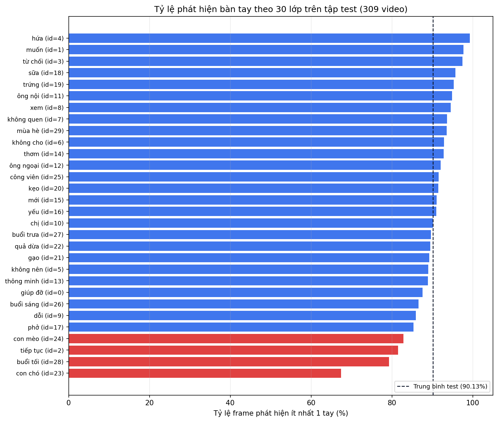

# Phân tích tỷ lệ phát hiện bàn tay trên tập `test` (309 mẫu, 30 lớp)

- **Trung bình chung (`hand_detect_ratio`):** 90.13%
- **Tay trái trung bình:** 82.06% | **Tay phải trung bình:** 73.35%
- **Số mẫu có `hand_detect_ratio < 70%`:** 38 / 309 mẫu

## Top 10 lớp có tỷ lệ phát hiện tay thấp nhất ở tập `test`

| Class ID | Nhãn | Số mẫu | TB có tay | Thấp nhất | Tay trái TB | Tay phải TB | Số mẫu < 70% |
| :---: | :--- | :---: | :---: | :---: | :---: | :---: | :---: |
| 23 | con chó | 10 | 67.44% | 40.00% | 59.25% | 57.71% | 6 |
| 28 | buổi tối | 9 | 79.25% | 46.48% | 62.83% | 71.73% | 1 |
| 2 | tiếp tục | 10 | 81.53% | 37.50% | 68.90% | 74.44% | 2 |
| 24 | con mèo | 10 | 82.86% | 31.75% | 76.17% | 75.94% | 2 |
| 17 | phở | 9 | 85.30% | 39.06% | 71.92% | 70.72% | 2 |
| 9 | dỗi | 10 | 85.89% | 22.81% | 81.48% | 65.51% | 2 |
| 26 | buổi sáng | 10 | 86.55% | 47.62% | 75.93% | 75.84% | 1 |
| 0 | giúp đỡ | 10 | 87.53% | 50.00% | 66.51% | 80.33% | 2 |
| 13 | thông minh | 10 | 88.91% | 40.00% | 84.72% | 60.57% | 2 |
| 5 | không nên | 10 | 88.98% | 59.02% | 80.51% | 76.18% | 2 |

## Các mẫu cụ thể bị mất tay nhiều nhất (`hand_detect_ratio < 50%`)

| Sample ID | Nhãn | Signer | Tỷ lệ có tay | Tay trái | Tay phải |
| :--- | :--- | :--- | :---: | :---: | :---: |
| `vsl2_chi_017739` | chị | `vsl2_signer_023` | 10.61% | 0.00% | 10.61% |
| `vsl2_yeu_024551` | yếu | `vsl2_signer_028` | 16.18% | 16.18% | 0.00% |
| `vsl2_doi_018502` | dỗi | `vsl2_signer_023` | 22.81% | 0.00% | 22.81% |
| `vsl2_khong_cho_024743` | không cho | `vsl2_signer_028` | 29.03% | 8.06% | 20.97% |
| `vsl2_con_meo_024676` | con mèo | `vsl2_signer_028` | 31.75% | 12.70% | 22.22% |
| `vsl2_doi_024723` | dỗi | `vsl2_signer_028` | 36.07% | 14.75% | 24.59% |
| `vsl2_tiep_tuc_018224` | tiếp tục | `vsl2_signer_023` | 37.50% | 32.81% | 35.94% |
| `vsl2_pho_024289` | phở | `vsl2_signer_028` | 39.06% | 23.44% | 23.44% |
| `vsl2_con_cho_013163` | con chó | `vsl2_signer_016` | 40.00% | 37.14% | 28.57% |
| `vsl2_thong_minh_018377` | thông minh | `vsl2_signer_023` | 40.00% | 0.00% | 40.00% |
| `vsl2_con_cho_004879` | con chó | `vsl2_signer_007` | 41.38% | 36.21% | 37.93% |
| `vsl2_thom_018293` | thơm | `vsl2_signer_023` | 41.38% | 0.00% | 41.38% |
| `vsl2_xem_024717` | xem | `vsl2_signer_028` | 45.28% | 39.62% | 18.87% |
| `vsl2_buoi_toi_017945` | buổi tối | `vsl2_signer_023` | 46.48% | 33.80% | 35.21% |
| `vsl2_buoi_sang_004436` | buổi sáng | `vsl2_signer_007` | 47.62% | 47.62% | 30.16% |
| `vsl2_con_cho_004878` | con chó | `vsl2_signer_007` | 48.39% | 38.71% | 40.32% |
| `vsl2_trung_024292` | trứng | `vsl2_signer_028` | 48.48% | 46.97% | 1.52% |
| `vsl2_thong_minh_024567` | thông minh | `vsl2_signer_028` | 49.09% | 49.09% | 0.00% |
| `vsl2_ong_noi_024711` | ông nội | `vsl2_signer_028` | 49.32% | 23.29% | 35.62% |

